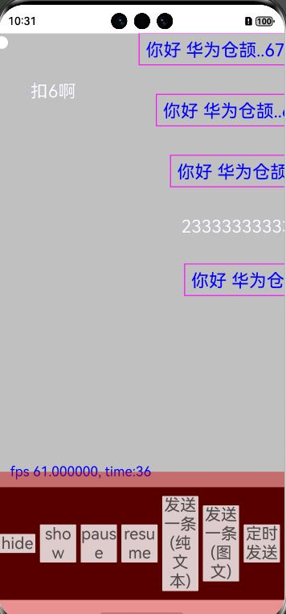
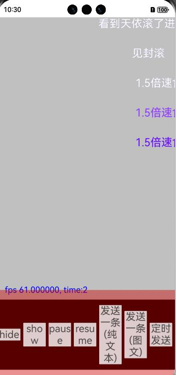
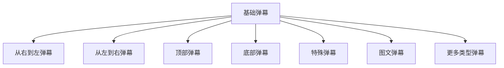

<div align="center">
<h1>bullet-screen-cj</h1>
</div>

<p align="center">


</p>

## 介绍

bullet-screen-cj 是一款弹幕框架，支持发送纯文本弹幕、设置弹幕在屏幕的显示区域、控制弹幕播放状态等功能

## 效果展示
<p align="left">


</p>

### 特性

1. 支持顶部弹幕
1. 支持底部弹幕
1. 支持左右滚动弹幕
1. 支持弹幕播放暂停继续
1. 支持纯文本弹幕
1. 支持特殊弹幕
1. 支持弹幕的图文混排
1. 支持GIF弹幕
1. 支持弹幕隐藏显示
1. 支持设置弹幕显示区域大小

## 软件架构


### 源码目录

```shell
/bullet-screen-cj             # 项目根目录
├─AppScope
├─doc                         # API文档和使用手册存放目录                   
├─entry                       # 示例代码文件夹    
├─hvigor                      # 构建工具目录              
├─danmaku                     # 弹幕库文件夹                   
│  └─src
│      └─main
│          ├─cangjie
│          │  └─src           # 库源代码目录
│          └─resources
├─README.md                   # 弹幕库介绍及使用说明
```

### 接口说明

主要类和函数接口说明详见 [API](doc/feature_api.md)

## 使用说明
1. 通过 module 引入
    1. 克隆下载项目
    2. 将 danmaku 模块拷贝到应用项目下
    3. 修改自身应用 entry 下的 oh-package.json5 文件，在 dependencies 字段添加 "danmaku": "file:../danmaku"
      ```json
      {
         "name": "entry",
         "version": "1.0.0",
         "description": "Please describe the basic information.",
         "main": "",
         "author": "",
         "license": "",
         "dependencies": {
            "danmaku": "file:../danmaku"
         }
      }
      ```
    4. 修改自身应用 entry/src/main/cangjie 下的 cjpm.toml 文件，在 [dependencies] 字段下添加 danmaku = {path = "../../../../danmaku/src/main/cangjie", version = "1.0.0"}
    ```toml
       [dependencies]
           danmaku = {path = "../../../../danmaku/src/main/cangjie", version = "1.0.0"}
    ```
    5. 在项目中使用 import danmaku.* 引用 bullet-screen-cj 项目
    ```cangjie
   import danmaku.*
    ```
2. 把 bullet-screen-cj 作为三方库依赖引入
    1. 目标工程把 bullet-screen-cj 依赖库作为 git submodule 引入

    ```
    > cd $工程根目录
    > mkdir third-party
    > cd third-party
    > git submodule add "https://gitcode.com/Cangjie-TPC/bullet-screen-cj.git"
    ```
    2. 修改自身应用 entry/src/main/cangjie 下的 cjpm.toml 文件，添加依赖
    ```toml
    [dependencies]
        danmaku = {path = "../../../../third-party/bullet-screen-cj/danmaku/src/main/cangjie", version = "1.0.0"}
     ```
    3. 在项目中使用 bullet-screen-cj 组件
    ```cangjie
    import danmaku.*
    ```

### 功能示例

用例代码在entry目录下 [功能示例](entry/src/main/cangjie/src/index.cj)


## 约束与限制

在下述版本验证通过：

    DevEco Studio 5.0.13.200
    Cangjie Support Plugin 5.0.13.200
    Cangjie Compiler: 0.53.20 (cjnative)

## 开源协议

本项目基于 [Apache License 2.0](./LICENSE) ，请自由的享受和参与开源。

## 参与贡献

欢迎给我们提交PR，欢迎给我们提交Issue，欢迎参与任何形式的贡献。